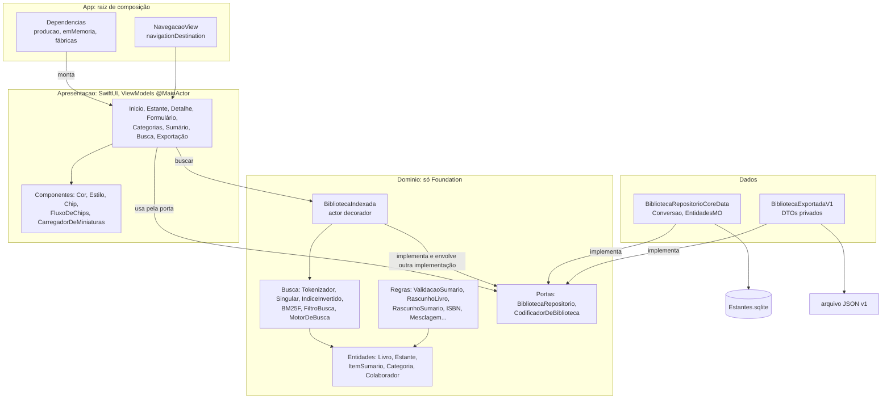
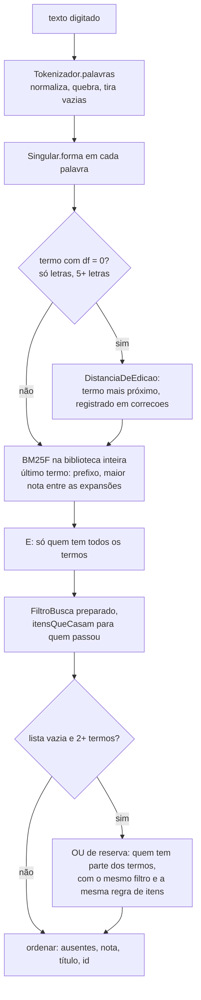
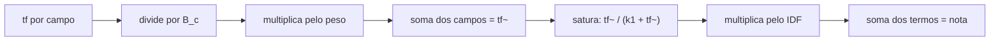
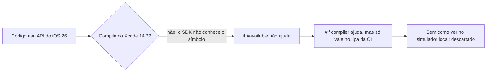
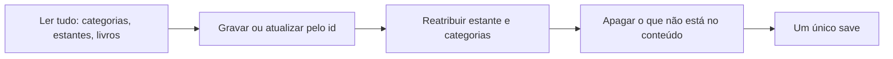
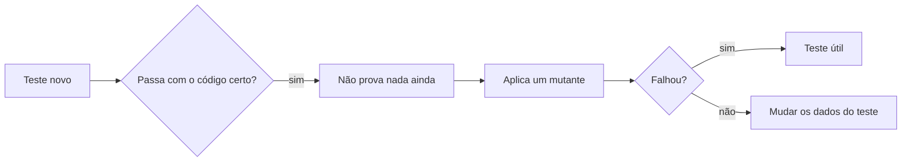

# Guia da Fase 2 — App

> Guia consolidado a partir de `docs/aprendizado/fase-2.md` (tarefas 2.1 a 2.9b, de 08/10 a 04/11/2026),
> de `docs/PLANO.md` (checklist da Fase 2 e "Histórico de decisões"), de `GLOSSARY.md` e do código em
> `ios/`, em 05/11/2026. Foi escrito para ser relido sem o código aberto: os trechos citados são cópias
> do repositório. As contas e os exemplos da Autoavaliação foram conferidos rodando as regras do
> `Dominio/` num programa à parte, ou com a conta refeita em Python. A suíte não foi rodada para escrever este guia; os totais de testes
> vêm do log, e o total de 548 confere com a contagem de `func test` no alvo de testes. Onde algo não
> pôde ser confirmado, isso está dito.

## 1. Resumo

A Fase 2 construiu **o app iOS inteiro que funciona sem rede**: estantes, livros agrupados por
prateleira, formulário com validação, categorias coloridas, sumário editado à mão, foto da miniatura,
busca local por índice invertido e BM25F, e exportação e importação da biblioteca em JSON. O código
foi organizado em camadas (`Dominio` só com Foundation, `Dados` com Core Data, `Apresentacao` com
SwiftUI, `App` como raiz de composição) e a suíte cresceu de 13 para 548 testes. O que se aprendeu se
concentra em três frentes: **modelar com tipos e regras puras** (valor em vez de referência, estados
inválidos irrepresentáveis, rascunhos); **recuperação de informação medida** (tokenização, BM25F,
conjunto de referência e o cuidado de não sobreajustar); e **provar o que se afirma** (teste de
mutação, contraste medido nos pixels, diagnóstico por experimento, o aparelho real derrubando uma
especificação que os testes aprovavam). A fase também ensinou os limites do SwiftUI no iOS 16: vários
defeitos vieram do ciclo de vida do framework, e nenhum teste de unidade os veria (tabela na seção 3.8).

> **O que este guia não afirma sobre a Fase 3.** O PLANO marca, desde 04/11, uma discussão obrigatória
> antes de iniciá-la: arquitetura (com telas novas), fluxo de dados, uso ou não do LexML e uso do OCR da
> Apple + Gemini. Nada disso foi decidido. Quando este guia cita a Fase 3, descreve o que se pensava
> quando uma decisão da Fase 2 foi tomada, e não um plano firme. A seção 3.14 separa o que existe no
> código do que só existe no papel.

## 2. Mapa da fase



Entre as camadas, as dependências apontam para o Domínio, nunca para fora dele. Quem liga as peças
concretas é só `Dependencias`: é lá que a `BibliotecaIndexada` recebe o repositório Core Data como base.

**O que a fase entregou:**

| Tarefa | Entrega | Testes ao fim |
| --- | --- | --- |
| 2.1, 2.1b | Entidades, porta, `ValidacaoSumario` (escrita pelo Ricardo) | 25 |
| 2.2 | Core Data, `BibliotecaRepositorioCoreData`, `Conversao` | não registrado no log (a 2.3a parte de 50) |
| 2.3a a 2.3f | Tokenizador, índice invertido, BM25F, filtros, motor | 144 |
| 2.3g, 2.3b (volumes) | Planejamento pelas fotos reais; volumes, página como texto, hífen | 171 |
| 2.3h, 2.3i | Conjunto de referência; plural, correção de digitação, OU de reserva | 224 |
| 2.4a a 2.4e | Lógica das telas principais | 308 |
| 2.4 (estilo) | Tokens, contraste, estilo de todas as telas, foto da miniatura | 361 |
| 2.5, 2.5b | Categorias; conferência do modelo contra livros reais | 408 |
| 2.6 | Sumário manual | 449 |
| 2.7 | Busca na interface, `BibliotecaIndexada` | 490 |
| 2.8, 2.8b | Exportar/importar, `.ipa` com exemplos; todas as ocorrências do sumário | 541 |
| 2.9, 2.9b | Modo escuro medido; auditoria dos testes | 548 |

A numeração "2.3b" foi usada em duas tarefas diferentes do log: o índice invertido (passo 2) e as obras
em vários volumes. Aqui a segunda é sempre chamada de "2.3b (volumes)".

## 3. Conceitos, do geral ao específico

### 3.1 Arquitetura: dependências que apontam para dentro

**Inversão de dependência e porta.** `BibliotecaRepositorio` é um `protocol` declarado no Domínio: um
contrato de métodos, sem implementação. O Domínio diz do que precisa; `Dados` importa o protocolo e o
implementa. É o "D" do SOLID, e o mesmo desenho aparece com o nome *Ports & Adapters* (hexagonal) em
`CodificadorDeBiblioteca`, porque o Domínio não pode conhecer o formato JSON. O ganho concreto: nos
testes entra um falso em memória, e nenhuma tela sabe que existe Core Data.

**Raiz de composição.** Um único lugar (`App/Dependencias`) conhece as classes concretas. Telas recebem
o ViewModel pronto; ViewModels recebem o repositório pelo `init`. Sem singletons, sem
`.environmentObject` (a falta do objeto só apareceria como queda em execução).

**A navegação segue a mesma regra.** As telas só emitem valores (`NavigationLink(value: estante)`); quem
constrói o destino é a `NavegacaoView`, em `App/`. Se a `InicioView` construísse a `EstanteView`,
Apresentação passaria a conhecer a montagem.

**Quando não abstrair.** A disciplina vale nos dois sentidos: uma porta só para a busca foi recusada
(um único uso), `Repositorio<T>` genérico foi recusado (esconde regras de cada entidade, como apagar
estante com destino), e o `switch` de carregando/erro/pronto das telas não virou componente genérico.
Duplicação *aparente* não é duplicação de *conhecimento*. A **regra de três** (extrair no terceiro uso)
guiou `.pressao`, `.alertaDeErro` e `.cartao()`.

**Dependência entre telas.** `EstanteView` chamava `InicioView.textoDaQuantidade` só para pluralizar.
Compilava e passava nos testes, mas criava uma fila (Estante → Inicio) onde deveria haver um V (telas →
componentes). A função foi para `Componentes/Quantidade.swift`.

### 3.2 Swift como linguagem de modelagem

**Valor × referência.** `struct` copia ao atribuir; `class` compartilha. Uma tela não muda o livro de
outra por acidente. `NSManagedObject` é ainda pior para as telas: preso à fila do contexto e atualizado
sozinho. **Quando não usar struct:** quando a identidade do objeto importa mais que o valor (cache
compartilhado, serviço com conexão).

**Opcional.** `Int?` é um enum (`.none`, `.some`) e outro tipo, não um `Int` que pode faltar. Swift não
faz *smart cast*: conferir `!= nil` não muda o tipo. `if let` desembrulha numa constante nova. `if var`
cria uma **cópia**, e mexer nela não mexe no original.

**Estados inválidos irrepresentáveis.** É o princípio que mais se repete na fase:

| Em vez de | Usou-se | O que deixa de existir |
| --- | --- | --- |
| Vários `Bool` na tela | `enum Estado` com valor associado | "carregando e com erro" |
| `Int` + `ehRomano: Bool` | `NumeroDePagina.arabico(Int)` / `.romano(Int)` | combinação incoerente |
| Um enum único de origem | `OrigemLivro` e `OrigemItemSumario` | item "vindo do Google Books" |
| `[UUID]` de categorias | `Set<UUID>` | repetição, ordem sem sentido |
| Campo `ordem` na struct | posição no array | duas verdades sobre a ordem |
| Closure com padrão `{ _ in }` | parâmetro obrigatório | ligação esquecida que compila |

**Identidade.** UUID gerado no aparelho: 122 bits aleatórios, sem coordenação central, o que permite
mesclar na importação. `NSManagedObjectID` não sobrevive à exportação, e um sequencial colide entre
bibliotecas.

**Agregado (DDD).** `Livro` é raiz e contém `itensSumario`: o sumário vive e é salvo com ele. `Categoria`
tem vida própria, por isso o livro guarda só os ids, e renomear não regrava livros.

**Fonte da verdade + derivado.** A página guardada é o texto impresso ("XI", "245–246", "s/n"); o número
é calculado (`numeroDaPagina`). Dois campos com a mesma informação podem divergir. O mesmo raciocínio
descartou guardar a miniatura à parte e o booleano do alerta.

**Ordem total e determinismo.** `Dictionary` e `Set` têm semente aleatória por processo. Três
consequências apareceram: soma de `Double` depende da ordem (`(0,1 + 0,2) + 0,3` difere de
`0,1 + (0,2 + 0,3)` na última casa), então os somatórios iteram em ordem fixa; toda ordenação precisa de
um último critério que nunca empate (o `id`); e o que vira arquivo precisa sair ordenado. Um comparador
deve ser uma ordem total estrita, e a documentação do `sorted` não promete estabilidade.

**Unicode não coincide com a intuição.** `Character.isNumber` aceita "½" e "٣"; `isLetter` aceita "º".
`wholeNumberValue` também devolve valor para dígitos árabes. Para formato de dado, defina o alfabeto
explicitamente (`isASCII`, conjunto de hífens). `Character` é um grapheme cluster, por isso percorrer
`Array(Character)` é seguro com acentos. `String` compara por escalares ("C" < "c"), e
`localizedStandardCompare` serve para **ordem** ("2ª" antes de "10ª"), nunca para igualdade: a regra
exata depende do locale, e por isso a igualdade usa `Normalizacao.chave`.

**Chave canônica + grafia de exibição.** Para comparar, a chave normalizada; para mostrar, a grafia do
usuário. Vale em `NomeDeCategoria`, `AgrupamentoPorPrateleira` e `SugestaoDePrateleira`. O
`returnsDistinctResults` do Core Data não resolve: compara os valores crus da coluna, e "o que é igual
para o usuário" é regra do Domínio.

### 3.3 Persistência: Core Data por dentro

**Dois bancos com papéis diferentes.** O Ricardo perguntou "que banco é esse?", e a resposta organiza a
arquitetura: o Core Data é a **biblioteca** do usuário, dentro do iPhone, offline; o Supabase da Fase 1
é o **catálogo**, no servidor. O app da Fase 2 não faz nenhuma chamada de rede.

**Core Data é um grafo de objetos**, com SQLite por baixo. O `NSManagedObjectContext` é a mesa de
trabalho: nada vai ao disco antes do `save()`. Cada contexto tem uma fila (`perform`), e tocar num objeto
fora dela é comportamento indefinido. Aqui, cada operação usa um contexto de fundo novo, e nenhum `MO`
sai do `perform`: só structs.

**Regras de exclusão.** Estante→livros e Livro→itens em *cascade*; Livro↔Categoria em *nullify* nos dois
lados. Toda relação tem inversa, e o Core Data mantém os dois lados coerentes.

**`@NSManaged` promete, não garante.** `@NSManaged var id: UUID` diz ao Swift que nunca é nil. Num objeto
recém-criado o valor é nil: ler trava o app. Foi o que transformou um teste vermelho em queda (seção 6.1).
Opcionais numéricos são `NSNumber?`, porque `Int32` não pode ser nil, e o teste confere que o livro
mínimo volta com `nil`, e não `0` ou `""`.

**Formatos planos.** `autores` é uma String com um nome por linha (nomes têm vírgula); `colaboradores`, uma
linha `papel⇥nome`. O problema clássico é o separador dentro do dado, e há duas saídas: *escaping*
(preserva, parser mais difícil) ou *saneamento* (troca o separador por espaço). Escolheu-se o saneamento,
porque num nome essa diferença não tem valor. E `"".components(separatedBy: "\n")` devolve `[""]`, não
`[]`.

**`/dev/null` como banco de teste.** É o mesmo motor SQLite da produção, sem gravar nada;
`NSInMemoryStoreType` é outro motor. O limite é que `/dev/null` nunca prova persistência, por isso há
um teste que fecha e reabre um arquivo de verdade.

**Upsert e TOCTOU.** "Busca pelo id; se não existir, cria." Dois `salvar` simultâneos do mesmo id, em
contextos diferentes, ambos não acham e ambos criam (*time-of-check to time-of-use*). A importação
contorna isso com um `save` único, mas o `salvar` avulso continua igual, sem restrição de unicidade no
modelo; a proteção é os ViewModels gravarem uma coisa de cada vez. Limitação conhecida, não resolvida.

**Sem migração, por enquanto.** O modelo foi editado direto porque não havia dados de usuário. Quem já
tinha o app no simulador precisou apagá-lo, pois o banco antigo não abre. O mesmo raciocínio pôs a
2.3b (volumes) e a 2.5b antes das telas e do JSON v1: o custo de mudar sobe depois disso. Agora que há
`.ipa` em aparelho, mudar o modelo já é um assunto a tratar com cuidado (leve ou mapeada).

### 3.4 Regras puras e rascunhos

**Função pura.** Entra valor, sai valor, sem banco, relógio ou tela. Por isso a regra mais difícil é
também a mais testada. O idioma é `enum` sem casos como namespace; usa-se `struct` quando há estado
(`FiltroBusca`) e protocolo quando precisa ser trocada em teste.

**Lista de problemas.** `ValidacaoSumario.validar` devolve erros e avisos em vez de lançar no primeiro,
para mostrar tudo de uma vez. Avisos não impedem salvar. A memória entre voltas do `for` mora fora dele,
e o "anterior" do nível (o item vizinho) é diferente do "anterior" da página (o último item com página
interpretável).

**Sequências de página.** Compara-se só dentro da mesma sequência: "XII" → "1" é troca, não regressão.
Comparar com o último *da mesma sequência* foi descartado: um índice remissivo em romanos no fim do livro
avisaria contra o prefácio. Falso alarme em validação ensina o usuário a ignorar avisos.

**Romano por ida e volta.** Soma com subtração (IV = −1 + 5) aceita lixo ("IIIII" dá 5). Em vez de listar
regras, reconverte-se o total à forma canônica por algoritmo guloso (tabela `M, CM, D, CD, C, XC, L, XL, X,
IX, V, IV, I`) e compara-se com a entrada. Faixa de 1 a 3999, e o teste vai e volta em todos.

**Rascunho e *parse, don't validate*.** Um formulário edita uma cópia que pode estar inválida.
`RascunhoLivro` guarda texto, porque `Int?` não representa "20a". A conversão acontece uma vez, em
`montar`, e dentro do Domínio os tipos já são os certos. O mesmo vale para `ISBN.normalizar`, que devolve
o valor canônico ou `nil`: ninguém guarda "validado mas não normalizado". Três efeitos decorrem disso:

- **Cancelar é grátis**: basta jogar o rascunho fora.
- **Editar preserva o que o formulário não mostra**: `montar(sobre:)` parte do livro existente, senão
  salvar apagaria o sumário em silêncio.
- **Obrigatoriedade depende da porta de entrada**: título, autor, editora e ano são exigidos só no
  formulário. `Livro` e Core Data continuam aceitando livros sem editora, porque outras origens podem não
  trazê-la.

**`nil` × `""`.** Iguais para o olho, diferentes para `Equatable` e para o banco. O teste de ida e volta do
`RascunhoSumario` achou isso. O mesmo vale para `volumeRotulo ?? ...` com "  ": texto digitado precisa ser
aparado antes de decidir "vazio". `Normalizacao.textoLimpo` usa `split` + `joined`, que apara as pontas e
colapsa espaços e quebras no meio.

**Dígito verificador.** Redundância deliberada. ISBN-13: pesos 1 e 3, verificador = (10 − soma % 10) % 10.
ISBN-10: pesos 10…1, soma múltipla de 11, "X" vale 10 e só no fim. Trocar um dígito muda a soma em
`peso × diferença`; como os pesos são coprimos do módulo, toda troca de um dígito é detectada. Já a
transposição de vizinhos muda a soma em `2(a − b)` no ISBN-13, múltiplo de 10 quando a diferença é 5: esse
caso **passa**. No ISBN-10, com módulo primo 11, toda transposição é pega. Na conversão 10 → 13, o
verificador é recalculado, porque as fórmulas são outras. O prefixo 978/979 é o que distingue um livro de
um EAN-13 qualquer.

**`onMove` conta antes da retirada.** Em `[A,B,C]`, mover A para 2 dá `[B,A,C]`. O `move(fromOffsets:)` é
extensão do SwiftUI, então o Domínio o escreve à mão: retira de trás para frente, desconta do destino os
retirados antes dele, insere o bloco.

**"Nada é corrigido sozinho".** `min(nivel + 1, maximo)` parece inofensivo, mas rebaixa em silêncio um item
acima do limite. A origem do item também não muda ao editar: ela diz de onde o item veio, não quem o tocou.

### 3.5 Busca: do texto à lista de resultados

A busca é só local. O pipeline completo, como está hoje:



#### Tokenização

Índice e consulta passam pela **mesma função**. Se divergirem, a falha é silenciosa: a busca não acha, sem
erro. As regras finais:

| Entrada | Saída | Regra |
| --- | --- | --- |
| "AÇÃO" | `acao` | folding: minúsculas, sem acento |
| "Lei 8.078/90" | `lei`, `8078`, `90` | ponto entre dígitos some |
| "art. 5º" | `art`, `5` | º e ª separam, apesar de o Unicode dizê-los letras |
| "sub-rogação" | `subrogacao` | hífen (U+002D, U+2010, U+2011) entre letras some |
| "1.710-1.779" | `1710`, `1779` | entre dígitos o hífen é intervalo e separa |
| "direito – penal" | `direito`, `penal` | travessão é pontuação |
| "de", "da", "em" | (nada) | palavras vazias, num `Set` por custo O(1) |

Termos curtos como `lei`, `art` e `cpc` ficam de propósito. As palavras vazias **não** entram em
`Normalizacao`, porque ela também compara categorias, e "Direito do Trabalho" e "Direito Trabalho" precisam
continuar diferentes. A saída é lista, com ordem e repetições: o BM25F precisa da frequência. Regra geral:
**perca informação o mais tarde possível**.

#### Plural (`Singular`)

Regras da mais específica para a mais geral, só em termos de letras com 4 ou mais caracteres, e só a
primeira que casa é aplicada: `oes→ao`, `ais→al`, `eis→el` (5+ letras), `ns→m`, vogal+`res`→vogal+`r`,
`zes→z`, vogal+`s`→tira o `s`. Há uma tabela de exceções (`onus`, `mais`, `pais`, `arts→art`, `civis→civil`).

Ao planejar isso, o Ricardo perguntou se a modificação alterava o que é armazenado e se podia produzir
resultados errados. A resposta correta tem quatro partes:

1. O texto gravado **nunca muda**: o singular existe só no índice em memória, refeito ao abrir o app, e nos
   termos da consulta.
2. Precisa valer **nos dois lados**, ou "prisoes" → `prisao` não casaria.
3. Índice descartável dispensa migração.
4. O risco real é o **falso positivo** (duas palavras no mesmo termo), daí a tabela de exceções. Formas
   estranhas ("simples" → `simple`) não importam, pois os dois lados as produzem igual.

O RSLP (8 etapas, cerca de 200 regras) foi descartado: corta derivação, juntaria "constitucional" e
"constituição", e o radical nem sempre é prefixo do que se digita.

**Normalizar muda as estatísticas, não só o casamento.** `cautelares`, raro, virou `cautelar`, mais comum, e
perdeu IDF: o ranking de "prisao caut" mudou por isso.

#### Índice invertido

Índice comum: livro → palavras. Invertido: palavra → livros, como o índice remissivo no fim de um livro. A
estrutura nasceu do que a fórmula consome (tf por campo, tamanhos, df, N), e não o contrário:

```text
postings:          termo -> livro -> campo -> frequência
documentos:        livro -> tamanhos por campo, Set de termos, itens do sumário tokenizados
somaDosTamanhos:   campo -> soma (média = soma / N, em O(1))
palavras escritas: palavra -> contagem por livro (para o prefixo)
```

Decisões que importam:

- **`remover` usa o `Set` de termos do livro**: O(termos do livro) em vez de varrer o vocabulário.
- **`adicionar` é idempotente**: remove a versão antiga antes, tornando impossível contar duas vezes.
- **Médias contam campos vazios**: é a definição clássica; contar só quem tem o campo incharia a média.
- **O índice guarda nomes de categoria, não ids**: é dado derivado, e renomear exige reindexar os afetados.
- **O que entra onde**: `parte`, `volume`, `volumeRotulo` e as **pontas** dos artigos vão no campo
  `subtitulo`; a `numeracao` soma no `sumario`; o nome do colaborador soma em `autores`, e o papel fica fora.
  Editora, ano, estante e CDDir são filtros, não texto ranqueado.
- **Palavras escritas**: quem digita "cautelare" não acha `cautelar` como prefixo. O índice guarda também as
  palavras como foram escritas; o prefixo procura nelas e devolve o termo singular.

`struct` com `mutating`, e dicionários são *copy-on-write*: copiar é barato até alguém escrever.

#### BM25F

| Método | Problema |
| --- | --- |
| Contar termos | não distingue raro de comum, nem título de sumário |
| TF-IDF linear | sem saturação: repetir 50 vezes vale 50 vezes |
| BM25 no texto concatenado | satura, mas perde os campos |
| Um BM25 por campo, somados | satura por campo: termo em muitos campos infla a nota |
| **BM25F** | pondera, normaliza por tamanho e satura **uma vez por termo** |

```text
IDF  = ln(1 + (N − df + 0,5) / (df + 0,5))        variante do Lucene: nunca negativo
B_c  = (1 − b_c) + b_c · tamanho_c / média_c      1 no tamanho médio; b = 0 desliga
tf~  = Σ_c peso_c · tf_c / B_c                    soma ANTES de saturar
nota = Σ_termos IDF · tf~ / (k1 + tf~)            cada termo vale no máximo o seu IDF
```



**Exemplo à mão** (do log; k1 = 1,2; título peso 3, b 0,5; sumário peso 1, b 0,75; N = 3, média do título 2 e
do sumário 2). Termo "prisão", df = 2, IDF = ln 1,6 = 0,470.

| Livro | Título / sumário | tf~ | Saturação | Nota |
| --- | --- | --- | --- | --- |
| A | "Prisão preventiva" / "Prisão em flagrante" | 3 + 1 = 4 | 4/5,2 = 0,769 | 0,3615 |
| B | "Processo penal" / 3 itens, um com "Prisão" | 1/1,375 = 0,727 | 0,377 | 0,1774 |

Saturando por campo, A teria 0,714 + 0,455 = 1,17 antes do IDF, contra 0,77. Essa é a inflação evitada.

**Extremos de k1.** Com k1 → 0, a fração tende a 1 e o termo vale "casou ou não". Com k1 → ∞, a fração é
quase `tf~/k1`: volta o problema linear.

**Parâmetros finais** (`ParametrosBM25F.padrao`):

| Campo | Peso | b | Estado |
| --- | --- | --- | --- |
| título | 3 | 0,5 | âncora da varredura; `b` confirmado (abaixo de 0,5 piora) |
| subtítulo | 2 | 0,5 | não discriminado |
| categorias | 1,5 | 0,3 | não discriminado |
| cddirCaminho | 1,5 | 0,3 | não discriminado |
| sumário | **0,25** | 0,75 | ajustado: 1,0 → 0,5 → 0,25 |
| autores | 0,5 | 0 | não discriminado |

"Não discriminado" não é "validado": nenhuma consulta do conjunto os distinguiu. `k1 = 1,2` está na mesma
situação.

**Proteções contra `NaN`.** Média 0 faz `fatorDeTamanho` devolver 1; `saturar(0)` devolve 0 (com k1 = 0 seria
0/0). `NaN` é silencioso e contamina a soma. `precondition` no `init` de `ParametrosBM25F` é adequado porque
os valores vêm do código; entrada do usuário nunca pode travar o app (a faixa de anos invertida simplesmente
não aceita ninguém).

#### Filtros

Predicado puro `Livro -> Bool`, com filtro vazio aceitando tudo. E entre dimensões; OU dentro de estantes e de
categorias (quem marca duas quer ampliar).

- **Autor**: cada termo digitado precisa ser prefixo de algum termo **do mesmo autor**, em qualquer ordem.
  "José Afonso Silva" acha "Silva, José Afonso da"; "antonio grinover" não casa com dois autores diferentes;
  "ilva" não acha "Silva"; "da" é vazio e conta como sem filtro.
- **Editora**: "contém" sobre a chave normalizada.
- **CDDir**: "começa com", sem espaços. A classificação é hierárquica, então prefixo de texto coincide com o
  subassunto.
- **Ano**: limites inclusivos; livro sem ano sai se há limite.
- **`Preparado`**: interpreta o filtro uma vez por consulta, e a regra "em branco = sem filtro" mora num só lugar.

**O filtro roda depois do BM25F.** O IDF é da biblioteca inteira; filtrar antes mudaria a nota do mesmo livro
ao ligar uma chip.

#### Motor: E, prefixo, correção, OU

**E entre os termos**, porque "prisão" aparece em dezenas de livros jurídicos. O custo é que um termo
desconhecido zera a lista. A ordem de ataque foi **vocabulário primeiro, OU por último**: consertar a causa é
melhor que esconder o sintoma.

**Prefixo só no último termo**, com 2+ caracteres. Entre as expansões, o livro fica com a **maior** nota, não a
soma, a mesma ideia da saturação. Um termo repetido ("prev prev") não expande.

**Correção de digitação.** Distância de Damerau-Levenshtein restrita (OSA): inserção, remoção, troca e
transposição de vizinhas custam 1. Programação dinâmica guardando três linhas, memória O(m), com dois cortes:
diferença de tamanho acima do limite e mínimo da linha acima do limite. Limite: nenhum erro abaixo de 5 letras
ou com dígitos, 1 até 8 letras, 2 a partir de 9. Candidato: menor distância, depois maior df, depois alfabética.
**Só termo com df = 0**, o que garante por construção que nenhuma consulta que já funcionava piora. O último termo só é
corrigido se nem o prefixo achou nada: "lassal" ainda está sendo digitado. A correção
nunca é silenciosa: vem em `correcoes`, e `corrigir: false` a desliga.

**OU de reserva.** Só com E vazio e 2+ termos distintos. Primeira chave de ordem: **menos palavras ausentes**
(nível de coordenação, o `coord` do Lucene antigo), porque um termo raro muito forte não deve vencer quem cobre
quase toda a consulta. E e OU nunca se misturam na mesma lista, então não há penalidade a calibrar.

#### O que mostrar dentro do livro

**Ranquear livros e escolher o que mostrar dentro de um livro são perguntas diferentes.** A primeira versão
mostrava o item de melhor nota BM25, como o PLANO mandava. No iPhone, buscar "coletivo" mostrou um item e
escondeu os outros: o requisito estava corretamente implementado e errado. Hoje, `itensDoSumario` lista os itens
com o maior número de palavras que algum item do livro alcança, na ordem do sumário e sem limite. A regra caiu
três vezes contra dados:

| Rodada | Regra | O que a derrubou |
| --- | --- | --- |
| 1 | Item precisa ter todas as palavras | #19: parte da consulta está no título, nenhum item tem todas |
| 2 | Ignorar palavras que o livro tem fora do sumário | "coletivo" também está no subtítulo do Tomo XLVIII |
| 3 | Maior contagem pura | o "direito" do título faz um cabeçalho genérico esconder "§ 5.153 Dissídios coletivos" |
| Final | Maior contagem **sem as palavras do título**, salvo se todas estiverem nele | custo aceito: em "direito coletivo", itens só com "coletivo" somem se algum tiver as duas |

### 3.6 Medir a busca

**Conjunto de referência.** 22 fichas reais (18 do LexML em grupos que se confundem, 4 livros fotografados) e 30
consultas com a resposta conhecida: 29 de ajuste e a #22 como sonda. Fichas inventadas seriam circulares, e os
tamanhos de campo seriam irreais. Está em Swift, no alvo de testes, com UUIDs fixos: o compilador acusa campo
renomeado, e o desempate por id fica estável.

| Métrica | Definição | Não vê |
| --- | --- | --- |
| top 1 | fração com posição 1 | 2º e 10º valem igual |
| top 3 | fração com posição ≤ 3 | 1º e 3º valem igual |
| MRR | média de 1/posição (0 se ausente) | pesa quase só o topo, de propósito |
| item certo | o item esperado está entre os mostrados, com o livro no top 3 | consultas sem item esperado |

**Empate pessimista.** p = 1 + quantos outros têm nota ≥ à do esperado, com tolerância de 1e-9. Empate decidido
por título é sorte, não relevância. A métrica mora em `EstantesTests/` (o app nunca calcula MRR) e tem testes
próprios: o instrumento precisa ser mais confiável que o medido.

**Ajuste × sonda.** Consulta de ajuste muda com algum peso. Sonda mostra uma limitação da arquitetura, que nenhum
peso conserta, e fica fora do MRR para não contaminá-lo.

**Sobreajuste e como foi evitado:** consultas escritas antes de ver o ranking; consulta existente nunca reescrita
para passar; consultas de risco escritas **antes** de medir (#28, #29, #30); não perseguir valor na ponta da grade.
Critérios criados depois de ver o resultado (como o "item certo" virar restrição) são registrados como tal.

**Descida por coordenadas.** Um parâmetro por vez, ótimo só local. Partindo de outro ponto chegou-se a outro
destino, porque peso e `b` do sumário interagem. Título fixo em 3 como âncora: multiplicar os pesos por c equivale
a dividir k1 por c, o que daria infinitas soluções equivalentes. Grade completa seriam 960 mil combinações, e mais
sobreajuste. A varredura só imprime: a decisão é humana, porque quem decide enxerga o risco.

**A história do peso do sumário** mostra o método funcionando:

| Momento | Peso | top 1 | MRR | Observação |
| --- | --- | --- | --- | --- |
| Linha de base | 1,0 | 0,895 | 0,939 | #1 em 2º, #11 em 3º |
| 2.3h | 0,5 | 0,947 | 0,965 | conserta o caso de peso puro; 0,25 descartado |
| 2.3i, antes da decisão | 0,5 | 0,923 | 0,962 | #28 reprova o piso: ponto combinado de parar e consultar |
| 2.3i, final | 0,25 | 1,000 | 1,000 | adotado após #29 e #30 não piorarem |

Os motivos para descartar 0,25 mudaram: um caiu (a parte estrutural da #11 sumiu com o plural), e os outros dois
foram medidos ou aceitos. #11, #23 e #28 são o **mesmo par** Fernandes × Maluf: não valem como três evidências.

**"Tudo em 1,000" é sinal de conjunto fácil, não prova.** Com 29 consultas, cada uma vale cerca de 3,4 pontos.
Pisos atuais: top 1 ≥ 0,96; top 3 = 1,0; MRR ≥ 0,98. Eles toleram uma troca entre 1º e 2º (um assert por consulta
seria frágil e acabaria desligado), e o teste foi visto reprovando. Novas consultas devem vir do uso real.

### 3.7 Concorrência

**`async` significa "pode suspender aqui"**, não "outra thread". `@MainActor` faz o compilador garantir que
`@Published` só muda na thread principal.

**Cancelamento é cooperativo.** Cancelar só marca a tarefa; quem roda precisa olhar `Task.isCancelled`. Três
armadilhas apareceram na fase, todas com a mesma raiz:

- `try?` em volta de um `await` cancelável engole o `CancellationError`;
- `Task.detached` não herda cancelamento, prioridade nem ator;
- a resposta velha ainda chega, então a conferência vem **depois** do `await`, antes de aplicar o resultado.

`.task(id:)` cancela a anterior quando o id muda, mas o `id` precisa conter tudo de que o resultado depende. Na
Busca, há um único caminho que dispara a consulta: a `chave`, que inclui texto, filtro, opção e uma `versao`.

**`actor` protege a memória, não uma fila de métodos.** Só um trecho mexe no estado por vez, mas em cada `await` o
actor fica livre: é a **reentrância**. Na `BibliotecaIndexada`:

1. A montagem do índice é cara. Sem cuidado, duas buscas começariam duas montagens. Por isso ela é uma `Task`
   guardada, e quem chega espera a mesma.
2. Isso cria outro problema: um descarte no meio da espera seria desfeito pela montagem velha ao terminar. O contador
   `geracao` sobe a cada montagem e a cada descarte, e quem termina só grava se a geração ainda for a sua
   (versionamento otimista).
3. "Gravar no banco + atualizar o índice" **não** é atômico: há um `await` entre os dois. Hoje as telas gravam uma
   coisa de cada vez; o comentário no código registra o risco.

**Copy-on-write na prática.** `guard var atualizado = motor` cria um segundo dono do buffer. Escrever com dois donos
copiaria o dicionário do índice inteiro. Por isso `motor = nil` antes de mutar. Só é seguro porque não há `await` entre
`motor = nil` e `motor = atualizado`.

**Idempotência** torna seguro "aplicar por cima" de uma montagem que talvez já contenha a mudança. A mesma ideia
aparece no `id` fixo do formulário de categoria e no `original = livro` após gravar: repetir depois de falha parcial
não multiplica efeitos.

### 3.8 SwiftUI e UIKit no iOS 16

**A View é um valor barato; o que sobrevive é `@StateObject`.** Ele só executa a criação na primeira vez, e o
`@autoclosure` no `init` evita criar um ViewModel descartado a cada reconstrução. O corpo de `navigationDestination` e
de `body` pode rodar várias vezes e ter o resultado descartado: **precisa ser função pura do estado**; efeitos vão em
`onAppear`, `task` ou ações.

**Navegação por valor.** `NavigationLink(value:)` constrói o destino só ao navegar e exige `Hashable`. `RotaDoLivro`
leva só o id: um tipo próprio evita capturar qualquer `UUID`, e o detalhe relê do banco, para não exibir cópia velha.

**Reler ao voltar.** A tela relê o banco ao reaparecer. O custo é de milissegundos, e elimina sincronização entre
telas. Uma `sheet` não dispara `onAppear` ao fechar, por isso lá se usa `onDismiss`.

**Binding derivado.** O alerta pede `Binding<Bool>`, o estado real é `String?`. Derivar mantém uma só fonte de verdade.

**Estado da folha × dado do pedido.** `confirmationDialog` zera o binding ao tocar numa ação. Se o `PedidoDeExclusao`
morasse ali, sumiria antes da segunda folha abrir. Por isso o ViewModel devolve o pedido, e a tela guarda quem está
aberto.

**Limites do framework encontrados, todos só visíveis olhando a tela:**

| Sintoma | Causa observada | Solução |
| --- | --- | --- |
| Alerta "Nova estante" só com "Cancelar" | no iOS 16, `.alert` esconde botão `.disabled` e não reavalia ao digitar | proteção só no ViewModel |
| App a 100% de CPU com a folha de sumário | `navigationDestination(for:)` numa folha aberta de dentro da pilha | `navigationDestination(isPresented:)` com `@State` |
| Barra de busca volta inativa | empurrar tela desliga o `.searchable` da raiz (visto no log) | tela Busca própria com `TextField` |
| Título não encolhe na 1ª entrada | a barra escolhe a rolagem ao aparecer, e a `ScrollView` chegava depois | rolagem desde o primeiro quadro |
| Barra do Detalhe sem fundo ao rolar | apresentador da foto no `.background`, em volta da `ScrollView` | apresentador dentro do conteúdo |
| `.tint` não chega aos alertas | alerta é `UIAlertController`, fora da árvore SwiftUI | proxy `UIAppearance` |
| "Back" em inglês | idioma do sistema vem do bundle | `CFBundleDevelopmentRegion: pt-BR` |
| `Menu` fecha a cada toque | `menuActionDismissBehavior` é do 16.4, não compila no Xcode 14.2 | tela empurrada |

Os mecanismos internos do SwiftUI nesses casos são inferência a partir de experimentos, sem documentação da Apple citada; o
log admite isso explicitamente na 2.5 e na 2.6. O que está provado é o que o experimento mostrou.

**Ponte com o UIKit.** Para a foto ampliada, o `UIScrollView` dá zoom, mola e inércia de graça. O gesto de puxar para
fechar só começa com `zoomScale == minimumZoomScale` e movimento vertical (o delegate arbitra os reconhecedores). Ao
soltar, decide-se por distância **ou** velocidade, porque um gesto curto e rápido também expressa intenção.
`.overFullScreen` mantém a tela de baixo, o que `fullScreenCover` não faz no iOS 16.

**Layout próprio.** `FluxoDeChips` implementa o protocolo `Layout`, com o algoritmo guloso isolado numa função pura
(seção 5.7). `LazyVGrid` cortaria texto grande.

**Acessibilidade tratada como requisito.** Dynamic Type (`@ScaledMetric` com teto; uma coluna em tamanhos de
acessibilidade; `minimumScaleFactor` recusado por desfazer o pedido do usuário); VoiceOver (`accessibilityLabel` sem
"·", `.accessibilityHidden` em ícones decorativos); Reduzir movimento com sinal estático de pressão; alvo de toque de
44 pt.

### 3.9 Imagens e memória

**O custo é o bitmap, não o arquivo.** Largura × altura × 4 bytes: um JPEG de 12 MP ocupa cerca de 3 MB em disco e 48 MB
para desenhar. Duzentos seriam 9,6 GB. Por isso `CGImageSourceCreateThumbnailAtIndex`, que decodifica já no tamanho
pedido. Opções: `ThumbnailMaxPixelSize` (lado maior), `FromImageAlways` (ignora a miniatura embutida), `WithTransform`
(orientação EXIF), `ShouldCacheImmediately` (decodifica agora, fora da thread principal).

**Guardar:** lado maior 1200 px, JPEG 0,8, cerca de 150 KB. Duzentos livros dão cerca de 30 MB; a original daria cerca de
1 GB; 600 px borraria a vista ampliada.

**`NSCache`** se esvazia sob pressão de memória, é seguro entre threads e só aceita objetos. A entrada guarda também o
lado reduzido, porque a largura varia com o Dynamic Type: se o pedido é maior que o guardado, reduz de novo. A foto grande
não entra nele (`fotoInteira`). Ao trocar a foto, `esquecer` remove a entrada e incrementa `trocas`, um contador sem
significado próprio que faz parte do `id` do `.task`.

**Efeito colateral escondido.** Perguntar "tem foto?" com `miniatura(ladoMaior: 1)` podia gravar um bitmap de 1 px no
cache. A correção foi dar nome à intenção: `temFoto(doLivro:)`.

**Falha parcial.** Salvar faz duas gravações (livro, foto), sem transação comum entre Core Data e arquivo. Mensagem honesta
("O livro foi salvo, mas a foto não.") e `original = livro` para o próximo Salvar atualizar em vez de duplicar. A foto só é
gravada no Salvar, e só se mudou.

### 3.10 Design visual: decidir com número e com o olho

**Tokens por papel.** Cor, fonte, espaço, raio e animação têm nome por função, e o hex fica visível no diff. A paleta final
(`Paleta`, em `Cor.swift`):

| Papel | Claro | Escuro |
| --- | --- | --- |
| fundo | `#FFFFFF` | `#000000` |
| cartao | `#FFFFFF` + sombra | `#1C1C1E` |
| superficie | `#AED3FC` | `#12305A` |
| destaque | `#0579B8` | `#AED3FC` |
| sobreDestaque | `#FFFFFF` | `#1C1C1E` |
| textoSecundario | `#4A5A62` | `#C9D6DC` |
| dica | `#66666B` | `#A0A0A6` |
| perigo | `#D70015` | `#FF6961` |
| sobreCategoria | preto | preto |

O destaque passou por `#1F5F73` (petróleo, "opaco, triste") e `#0A5FD6` (colado no índigo das categorias) até `#0579B8`,
escolhido entre degraus de luz gerados em OKLCH.

**Contraste WCAG.** Lineariza cada canal sRGB, calcula L = 0,2126 R + 0,7152 G + 0,0722 B, e razão = (L1 + 0,05) / (L2 + 0,05).
Pisos: **4,5:1** para texto (1.4.3) e **3:1** para ícone e forma (1.4.11). Decoração não tem piso.

Quatro lições vieram de medir:

- **No escuro, os papéis trocam**: a cor "escura" é a que cumpre o papel com contraste, não a mesma escurecida.
- **Cor com alfa não tem contraste definido**, só composta sobre o fundo real. A primeira dica deu 4,9:1 nos formulários e
  4,07–4,33:1 no campo da Busca. O `.secondary` do sistema, por isso, virou token próprio.
- **Um teste de contraste só prova os pares da lista.**
- **Contraste alto demais também é defeito**: `textoSecundario` como dica pareceria texto digitado.

**O número elimina; o olho escolhe.** Critérios diferentes não se substituem: contraste não desempatava `#0A5FD6` e `#0369A1`,
e o que decidiu foi a distinção do índigo. O "amarelado" que o Ricardo percebeu não estava no pixel (fundo medido `#FFFFFF`); a
hipótese é contraste simultâneo com a capa de exemplo. ΔE76 é imprecisa nos azuis: serve para ordenar.

**Chip de categoria.** Existe um limite físico: amarelo legível sobre branco não parece amarelo. Solução por divisão de trabalho:
fundo pastel a 15% e contorno vivo guardam a identidade (decoração); o texto é o mesmo matiz escurecido até cerca de 4,6:1; a
informação fica no texto, nunca só na cor. Os tons foram **congelados em hex**, porque o teste roda no iOS 16 e o `.ipa` no iOS
26, cujas cores do sistema podem mudar.

**`Form` × cartões.** A ferramenta segue a interação: `Form` nativo no Formulário (apagar, arrastar, foco, fuga do teclado de
graça), `ScrollView` com cartões no Detalhe (leitura). Sobrescrever fundo semântico faz sumir elementos em algum modo: numa folha
escura, o fundo agrupado vira `#1C1C1E`, a mesma cor do cartão.

**`#available` × `#if`.** O primeiro é checagem em **execução**, e o código ainda precisa compilar. O segundo é em **compilação**.



Daí o "vidro" imitado (`.ultraThinMaterial`, borda fina, mola) só em elementos flutuantes. `ButtonStyle` não é `View`: `makeBody`
devolve uma `View` privada para ler `@Environment`.

### 3.11 Exportar e importar: um contrato que dura

**DTO em vez de `Codable` nas entidades.** O formato do arquivo é um contrato separado do modelo: renomear um campo não quebra
backups. Cor ou origem desconhecida torna o arquivo inválido, em vez de virar um padrão que esconde o problema. (Na **leitura do
banco**, ao contrário, `?? .cinza` é degradação aceita.)

**Versão lida primeiro.** Um envelope lê só `{ "versao": N }`. Um v2 pode ter outra estrutura, e decodificar com os tipos do v1
daria um erro genérico e enganoso.

**Saída determinística.** `sortedKeys`, `categoriaIds` ordenados, sem `exportadoEm`: dois backups da mesma biblioteca saem iguais
byte a byte. Datas em ISO 8601 com milissegundos; o que passa disso se perde.

**Validar na fronteira.** Arquivo é entrada não confiável, mesmo sendo "seu". Rejeita-se inteiro, porque importar "o que dá"
esconde perdas. Cada camada que depende de um invariante o garante ou o verifica: tirar a validação de `importar` derrubou o
processo com `Duplicate values for key`. `Dictionary(uniqueKeysWithValues:)` com chave repetida é *trap*, não erro tratável.

**Atomicidade com um contexto e um `save`.** O contexto é a área de rascunho: um `throw` antes do `save` significa que o banco
nunca viu nada.

**Gravar antes, apagar depois.** A ordem protege da cascata: se o arquivo move L de A para B e remove A, apagar A primeiro levaria
L junto.



O livro que continua é o mesmo objeto, por isso a foto, fora do arquivo, sobrevive.

**Mesclagem: a ordem é especificação.** O arquivo vence por UUID (é um backup). Com nomes únicos de categoria:

1. O arquivo renomeia, vencendo pelo UUID.
2. Se o renome colide com uma categoria que só existe no aparelho, a do aparelho é **absorvida pela do arquivo**.
3. Só então as categorias *novas* do arquivo procuram nome igual: achando, **reaproveitam a existente**.

O `[UUID: UUID]` de remapeamento é aplicado aos livros. Invertendo 2 e 3, uma categoria nova poderia reaproveitar outra que logo
sumiria, deixando livros apontando para um id morto.

**Instantâneo não é garantido.** Três leituras seguidas podem misturar momentos se algo escrever no meio. Não há escritor
concorrente hoje; está comentado.

**Compilação condicional e artefato.** `#if DEBUG || EXEMPLOS`: fora da condição, o código nem entra no binário. `$(inherited)`
acrescenta às condições em vez de substituí-las. A conferência foi com `strings` no binário: quando a pergunta é "o que vai dentro",
verifique o artefato.

**Ler arquivo de fora do app** exige `startAccessingSecurityScopedResource()`, e a falha aparece só com arquivos externos. E
`onChange` não dispara com valor igual: `ImportacaoPendente` ganhou um `id`, para dar identidade ao evento.

### 3.12 O que faz um teste valer

**Teste verde não prova que o código está certo**: prova que faz o que os testes perguntam. A frase nasceu na 2.1b e voltou na 2.9b
com definição operacional: **fraco é o teste que continuaria verde com uma implementação errada óbvia**.

**Teste de mutação.** Sabota-se o código de propósito. Algum teste reclamou? O mutante morreu. Ninguém reclamou? Há lacuna. Foi feito à
mão: ferramenta automática não compensaria para os suspeitos da auditoria, e cobertura de linhas não mede isso (a linha executou, mas o
resultado foi conferido?).



**Três técnicas para escolher dados:**

- **Valor-limite**: erros de um a mais moram nas fronteiras. O limite de correção muda entre 8 e 9 letras; testar os dois pega `>=` contra `>`.
- **Dados que separam hipóteses**: na escada `[1,2,3]`, "nível do item", "posição + 1" e "anterior + 1" coincidem; `[1,1,1]` dá 1, 3 e 2. Em
  `ValidacaoSumario`, `10, 50, 20` não separa "a anterior" de "a maior já vista"; `50, 20, 30` separa.
- **Entrada diferente da saída**: reduzir 800×1200 esperando 800×1200 passaria sem reduzir nada.

**Tautologia × congelamento.** O esperado precisa vir de fonte independente: Wikipédia no ISBN, WebAIM no contraste, Python nas datas, uma
captura aprovada nos hex. O teste da paleta não prova que a cor é bonita, e sim que ninguém a muda sem perceber.

**Teste que nasce verde** é aceitável se você sabe dizer qual mudança futura o deixaria vermelho. **Teste que não consegue falhar** é decoração
("preparar duas vezes não duplica", num motor que guarda por id).

**Determinismo:** com 2 ids, uma implementação sem ordenação acerta 1 vez em 2; com 5, 1 em 120. Aumente o espaço até o acaso ser desprezível.

**Isolar o alvo.** O teste do índice falhou com "bastos" porque o índice guarda `basto`. A busca funcionava; o teste é que dependia de uma regra
vizinha. Trocou-se para "aurelio", mantendo o teste ponta a ponta no motor.

**Dublê.** `BibliotecaRepositorioEmMemoria` é um *fake*: funcional e com interruptores de falha, diferente de um *mock* que verifica chamadas. Se
divergir do contrato real, os testes de ViewModel mentem. Um contador na porta permite observar o efeito do cache sem olhar a implementação.

**Limite assumido.** Sem XCUITest, a barra de navegação e os defeitos de ciclo de vida não têm teste de regressão, e a reentrância da
`BibliotecaIndexada` também não: exigiria um falso que pausa a leitura.

### 3.13 Método de diagnóstico

**Ler a mensagem antes de diagnosticar.** Na 2.1b, até os testes de nível mostravam `[]`, e a pista estava ali. Na foto, o domínio e o código do erro
derrubaram a suspeita de tamanho.

**Sinais rápidos:**

| Sintoma | O que indica | Instrumento |
| --- | --- | --- |
| CPU a 100% | laço | `ps`, `sample` |
| CPU a 0% | espera ou deadlock | `ps`, `sample` |
| "Funciona na segunda vez" | ordem de eventos, não lógica | laço de captura com controle |
| "Restarting after unexpected exit" | acesso inválido | relatório `.ips` |
| `EXC_BAD_ACCESS` sem relação com a mudança | layout de struct velho no build incremental | apagar `DerivedData/Estantes-*` |
| Falta a linha "Executed" no resumo | o processo de testes caiu | log do `testar.sh` |
| "Testing failed" sem nenhum `error:` | infraestrutura do simulador | rodar de novo |

**Um experimento muda uma coisa só.** No laço do `navigationDestination`: sem o destino, a folha abre (causa localizada); tipo próprio no lugar de `UUID`
continua em laço (hipótese descartada); `isPresented` resolve.

**Causa × mecanismo.** Na barra do Detalhe, tirar `.fotoAmpliada` curou, mas trocar o `UIViewControllerRepresentable` não: a causa estava certa, o
mecanismo suposto não. Era a posição.

**Controle.** Um laço de reprodução precisa distinguir vermelho de verde. "Ida e volta ao Detalhe" dava verde, o que provou que o laço separa os casos, e
o vermelho no `main` provou que o defeito não era regressão da branch.

**Remendo tem limite.** Cinco tentativas em volta do `.searchable`. Se a mesma classe de defeito reaparece, mude a estrutura para não depender dela.

**Ao reverter, confirme a causa.** A `VStack` do Inicio foi revertida por um defeito que era antigo, e voltou depois. Uma ideia boa quase foi embora por
culpa de outro bug.

**Elimine variáveis.** Capturas contaminadas foram o Ricardo mexendo no simulador ao mesmo tempo. Dois `testar.sh` juntos corrompem o DerivedData.

**Medir, inclusive a si.** "Categorias sumidas" eram categorias que o próprio Ricardo apagara: perguntou-se, em vez de supor um bug.

### 3.14 O modelo contra o mundo real, e o que fica para depois

**Validar o plano contra dados.** As fotos de 4 livros derrubaram a suposição de ISBN e ficha CIP na maioria: nenhum tinha ISBN, e 3 eram de 1954–1972.
Quatro livros não são estatística, mas bastam para derrubar uma suposição. O efeito na Fase 2 foi concreto: `volume`, `volumeRotulo`, `parte`, `serie`,
`local`, `artigosInicio`/`artigosFim`, página como texto e numeração indexada.

**Lacuna do modelo × omissão do extrator.** Conferindo as **fotos** (fonte primária), e não só o JSON do Gemini:

- *Lacuna do modelo*: está impresso e não há campo. Remédio: mudar o esquema. Exemplos: a matéria do tomo, o prefaciador.
- *Omissão do extrator*: há campo e não foi preenchido. Remédio: prompt e validação. Exemplos: títulos de § cortados com "…", o "32" da CDU.

Conferir o modelo só contra o extrator herda as omissões dele. Daí nasceram `Colaborador`, a regra "matéria no `subtitulo`" e o "Contrato de campos" do PLANO.

**YAGNI no modelo.** Só entra campo que muda comportamento. `rotulo` separado de `numeracao` foi descartado; `papel` ficou texto livre, porque um enum congelaria
o valor bruto no JSON v1. Lista plana com `nivel` representa qualquer profundidade, e a árvore é reconstruível com uma pilha.

**O que existe e o que é só papel, em 05/11/2026:**

| Existe no código | Só no PLANO, sujeito à discussão da Fase 3 |
| --- | --- |
| `OrigemLivro`, `OrigemItemSumario` | `LinhaOCR` e os parsers de ficha CIP, folha de rosto e sumário |
| `RascunhoLivro` e `ISBN.normalizar`, reaproveitáveis | `FichaExtraida`, câmera, scanner, tela de confirmação |
| `ValidacaoSumario`, regra única por origem | Ordem de confiança das fontes e pontuação com volume/edição |
| JSON v1 com `origem` preservada | Uso do catálogo LexML e chamadas ao Supabase pelo app |
| "Contrato de campos", como documento | Uso de OCR da Apple + Gemini e as Edge Functions |

A coluna da direita registra a intenção de quando foi escrita. Pela marcação de 04/11 no PLANO, ela será rediscutida antes de qualquer implementação.

## 4. Decisões de arquitetura

As decisões da Fase 3 que aparecem no PLANO ficam de fora de propósito (seção 3.14).

| Decisão | Alternativas | Motivo |
| --- | --- | --- |
| Structs no Domínio | `NSManagedObject` nas telas; classes | Sem estado compartilhado; testes sem banco; telas independentes da fila do contexto |
| UUID gerado no aparelho | `NSManagedObjectID`; sequencial | Permite mesclar na importação |
| Um repositório só, por porta | `Repositorio<T>`; um por entidade | Regras próprias de cada entidade; "substituir" é uma transação única |
| Posição no array é a ordem do sumário | Campo `ordem` na struct; `NSOrderedSet` | Uma verdade só; substituir em bloco |
| Classes `MO` à mão | Codegen automático | O automático criaria `Livro` e colidiria com as structs |
| `autores` em String por linha | Entidade `Autor`; Transformable | Só se exibe e se busca; nomes têm vírgula |
| Índice invertido em memória, BM25F | Varrer tudo; Lucene-like em disco; BM25 por campo | Cabe em memória; offline; termo não infla por estar em vários campos |
| Índice guarda nomes de categoria | Ids resolvidos na consulta | O BM25F precisa do texto; aceita-se reindexar os afetados |
| Filtro depois do BM25F | Filtrar antes | IDF estável ao ligar uma chip |
| E com OU de reserva | OU sempre; ignorar desconhecidos; misturar com penalidade | Domínio com vocabulário repetitivo; notas de grupos diferentes não se comparam |
| Plural por regras mínimas | RSLP; indexar as duas formas | Explicável; não junta conceitos; não distorce frequências |
| Correção por OSA, só com df = 0 | Trigramas; corrigir termos existentes; esperar a Fase 5 | Não piora consulta que funciona; vocabulário pequeno |
| Peso do sumário 0,25 | 1,0; 0,5; estender a grade | Medido com consultas de risco escritas antes; não persegue a ponta |
| Conjunto de referência em Swift, pisos agregados | JSON; um assert por consulta; só imprimir | Compilador acusa mudança; tolera troca; regressão não passa calada |
| Todos os itens que casam, na ordem do sumário | Melhor nota; "3 + mais N"; E por item | Teste no iPhone; página em ordem; nada escondido |
| Página como texto + número derivado | `Int?`; `Int` + flag | Romanos e intervalos; sem duas verdades |
| Numeração única, indexada | Dois campos `rotulo` e `numeracao` | Cada item tem um só prefixo; ruído pequeno |
| `Colaborador` separado de `autores` | Juntar; enum de papéis; `[String]` | Prefaciador não é coautor no cabeçalho ABNT; papel como impresso |
| Matéria no `subtitulo`, `parte` só para a divisão | Campo `materia`; juntar em `parte` | Mesmo papel na busca; sem esquema a mais antes do JSON v1 |
| Rascunho como tipo do Domínio | `Int?` no ViewModel; `NumberFormatter` | Estado inválido precisa existir para ser apontado |
| Obrigatórios só no `RascunhoLivro` | Só título; `optional = NO` no banco | Escolha do Ricardo; outras origens podem não ter os dados |
| ISBN no Domínio, forma de 13 dígitos | Validar na tela; só o verificador; só ao mudar | Reaproveitável; EAN qualquer não passa |
| Lógica primeiro, estilo depois, tela a tela | Tudo junto | Não gastar estilo em fluxo que ainda muda |
| Tokens em código | Asset catalog | Hex no diff; o teste resolve cada modo |
| Tons de categoria congelados em hex | Cores do sistema ao vivo | iOS 16 no teste, iOS 26 no `.ipa` |
| Paleta de 10 categorias, sem azul nem turquesa | Enum antigo com azul e turquesa; só 9, sem cinza | Azuis colidem com o destaque; o cinza dá uma etiqueta neutra |
| Vidro imitado, só em flutuantes | Liquid Glass com `#if compiler`; vidro em tudo | Não verificável localmente; legibilidade |
| `Form` no Formulário, cartões no Detalhe | `ScrollView` com cartões em tudo | Editar × ler |
| Foto livre por livro, 1200 px, JPEG 0,8 | Duas fotos; original; 600 px | Capa lisa não identifica; cerca de 30 MB por 200 livros |
| Miniatura calculada com ImageIO, em `NSCache` | Miniatura gravada; `UIImage(data:)` | Sem dois campos em sincronia; memória |
| Foto ampliada por UIKit, `.overFullScreen` | `fullScreenCover`; overlay; gestos SwiftUI | Fundo esmaecido no iOS 16; zoom pronto |
| Sumário numa folha própria, grava no Salvar | Dentro do formulário; gravar a cada mudança | Tamanho; mantém o Cancelar |
| Origem preservada ao editar item | Virar `manual` | Mantém o rastro da fonte |
| `BibliotecaIndexada`: decorador `actor` | Cada ViewModel avisar; remontar por busca; `@MainActor` | Um lugar só cuida da invariante; não trava a interface |
| Tela "Busca" própria | `.searchable` com remendos; folha com pilha própria | Controle do estado vale mais que o visual nativo |
| Rolagem na tela desde o primeiro quadro | Esconder o "carregando" | A barra escolhe a rolagem ao aparecer |
| Importação atômica + regra pura de mesclagem | Laço de `salvar` | Backup pela metade é o pior resultado |
| Arquivo vence por UUID | Aparelho vence; mais recente vence | É backup; "recente" pediria data de alteração |
| JSON v1 por DTO, sem fotos, rejeita o incoerente | `Codable` nas entidades; zip; importar o que der | Contrato separado; legível; previsível |
| `.ipa` com exemplos por flag | Em memória; carga automática; build a cada push | Sobrevive ao iOS fechar o app; permite testar o vazio; economiza CI |

## 5. Padrões usados

### 5.1 Repository e porta

`Dominio/Portas/BibliotecaRepositorio.swift`. Vale com mais de uma implementação plausível; com uma só e sem chance de mudar, é cerimônia.

```swift
protocol BibliotecaRepositorio {
    // MARK: Estantes

    func estantes() async throws -> [Estante]
    /// Cria ou atualiza (pelo `id`).
    func salvar(_ estante: Estante) async throws
    func quantidadeDeLivros(naEstante estanteId: UUID) async throws -> Int
    /// Apaga a estante. Com `destino`, os livros são movidos para lá antes; sem ele, vão junto (cascata).
    /// Lança erro se o `destino` não existir ou for a própria estante, sem apagar nada.
    func apagarEstante(id: UUID, moverLivrosPara destino: UUID?) async throws
```

### 5.2 Raiz de composição

`App/Dependencias.swift`. Só aqui se escolhe o concreto.

```swift
init(repositorio base: BibliotecaRepositorio) {
    biblioteca = BibliotecaIndexada(base: base)
    repositorio = biblioteca
    miniaturas = CarregadorDeMiniaturas(repositorio: repositorio)
}

/// O app de verdade: Core Data gravando em disco. Lança erro se o banco não abrir.
static func producao() throws -> Dependencias {
    let persistencia = try PersistenceController()
    return Dependencias(repositorio: BibliotecaRepositorioCoreData(persistencia: persistencia))
}
```

### 5.3 Mapper na fronteira

`Dados/Persistencia/Conversao.swift`. Nenhum `MO` vaza. Em `id: id`, o da esquerda é o rótulo do parâmetro; o da direita, o valor lido de `self`.

```swift
func paraDominio() -> Estante {
    Estante(id: id, nome: nome, criadaEm: criadaEm)
}
```

### 5.4 Rascunho que preserva o que não edita

`Dominio/Regras/RascunhoLivro.swift`. Partir da `base`, nunca reconstruir.

```swift
func montar(sobre base: Livro?) -> Livro? {
    guard problemas().isEmpty, let titulo = Normalizacao.textoLimpo(titulo) else { return nil }

    var livro = base ?? Livro(estanteId: estanteId, titulo: titulo, origem: .manual)
    livro.estanteId = estanteId
    livro.titulo = titulo
    livro.subtitulo = Normalizacao.textoLimpo(subtitulo)
```

### 5.5 Enum com valor associado e padrão em tupla

`Dominio/Regras/ValidacaoSumario.swift`. Qualquer combinação de sequências diferentes cai no `default`.

```swift
private static func paginaVoltou(de anterior: NumeroDePagina, para atual: NumeroDePagina) -> Bool {
    switch (anterior, atual) {
    case let (.arabico(a), .arabico(b)), let (.romano(a), .romano(b)):
        return b < a
    default:
        return false
    }
}
```

### 5.6 Função pura com sentinela e desempate explícito

`Dominio/Regras/CorSugerida.swift`, escrita pelo Ricardo. Na leitura, `default:` não insere nada; é ele que enxerga as cores com zero uso. O `<` estrito mantém a primeira da paleta.

```swift
var menorUso = Int.max
var corMenosUsada = CorCategoria.cinza
for cor in CorCategoria.allCases {
    let uso = usosPorCor[cor, default: 0]
    if uso < menorUso {
        menorUso = uso
        corMenosUsada = cor
    }
}
return corMenosUsada
```

### 5.7 Algoritmo isolado do framework

`Apresentacao/Componentes/FluxoDeChips.swift`. A parte difícil do `Layout` é função pura e testável. A guarda `!atual.isEmpty` impede linha vazia quando um chip não cabe em nenhuma.

```swift
for (indice, largura) in larguras.enumerated() {
    if !atual.isEmpty && ocupada + espaco + largura > larguraDisponivel {
        linhas.append(atual)
        atual = []
    }
    ocupada = atual.isEmpty ? largura : ocupada + espaco + largura
    atual.append(indice)
}
```

### 5.8 Decorate-sort-undecorate

`Dominio/Busca/MotorDeBusca.swift`. Chave cara calculada uma vez por resultado, não a cada comparação. Não vale quando a chave já é um campo guardado.

```swift
resultados
    .map { (resultado: $0, titulo: Normalizacao.chave($0.livro.titulo), id: $0.livro.id.uuidString) }
    .sorted { a, b in
        let ausentesA = a.resultado.palavrasAusentes.count, ausentesB = b.resultado.palavrasAusentes.count
        if ausentesA != ausentesB { return ausentesA < ausentesB }
        if a.resultado.nota != b.resultado.nota { return a.resultado.nota > b.resultado.nota }
        if a.titulo != b.titulo { return a.titulo < b.titulo }
        return a.id < b.id
    }
    .map { $0.resultado }
```

### 5.9 Validação de invariantes no `init` (fail fast)

`Dominio/Busca/BM25F.swift`. `let` impede contornar depois. Para entrada do usuário ou da rede, use `init?` ou `throw`.

```swift
init(k1: Double, pesos: [CampoBusca: Double], b: [CampoBusca: Double]) {
    precondition(k1 >= 0, "k1 não pode ser negativo")
    precondition(pesos.values.allSatisfy { $0 >= 0 }, "pesos não podem ser negativos")
    precondition(b.values.allSatisfy { (0...1).contains($0) }, "b fica entre 0 e 1")
```

### 5.10 Decorador

`Dominio/CasosDeUso/BibliotecaIndexada.swift`. Grava primeiro: se `try` lançar, o índice não é tocado. Não use se o comportamento novo pedir outra interface, ou se houver um único chamador.

```swift
func salvar(_ livro: Livro) async throws {
    try await base.salvar(livro)
    await atualizarIndice { $0.atualizar(livro) }
}
```

### 5.11 Tarefa compartilhada e invalidação por geração

Mesmo arquivo. Serve a qualquer resultado assíncrono que possa chegar atrasado.

```swift
let minhaGeracao = geracao
do {
    let montado = try await tarefa.value
    if geracao == minhaGeracao, motor == nil {
        motor = montado
        montagem = nil
    }
    return motor ?? montado
} catch {
    if geracao == minhaGeracao { montagem = nil }
    throw error
}
```

### 5.12 Um dono só para mutar no lugar

Mesmo arquivo. Sem `await` entre as duas atribuições, ninguém entra na janela.

```swift
guard var atualizado = motor else { return }
// Sai do `motor` antes de mudar: com dois donos, o dicionário do índice seria copiado inteiro.
motor = nil
mudanca(&atualizado)
motor = atualizado
```

### 5.13 Resposta atrasada não cobre a nova

`Apresentacao/Busca/BuscaViewModel.swift`.

```swift
let resposta = try await biblioteca.buscar(texto, filtro: filtro, corrigir: !exatamente)
// A tela cancela a busca da tecla anterior (`.task(id:)`), mas o actor termina o que começou:
// a resposta velha não pode cobrir a nova.
guard !Task.isCancelled else { return }
```

### 5.14 Binding derivado

`Apresentacao/Componentes/AlertaDeErro.swift`. O booleano nunca é estado próprio, então não sai de sincronia.

```swift
func alertaDeErro(_ mensagem: Binding<String?>) -> some View {
    alert("Algo deu errado", isPresented: Binding(
        get: { mensagem.wrappedValue != nil },
        set: { if !$0 { mensagem.wrappedValue = nil } }
    )) {
```

### 5.15 Tokens de design por papel

`Apresentacao/Componentes/Cor.swift`. Não vale para cor única e local.

```swift
static let superficie = UIColor(claro: 0xAED3FC, escuro: 0x12305A)
static let destaque = UIColor(claro: 0x0579B8, escuro: 0xAED3FC)
```

### 5.16 Envelope com versão lida primeiro

`Dados/Exportacao/BibliotecaExportadaV1.swift`.

```swift
// A versão primeiro: um arquivo mais novo pode ter outra estrutura inteira.
guard let envelope = try? decodificador.decode(EnvelopeDTO.self, from: dados) else {
    throw ErroDeImportacao.arquivoInvalido
}
if envelope.versao > Self.versao { throw ErroDeImportacao.versaoMaisNova(envelope.versao) }
```

### 5.17 Transação por contexto descartável

`Dados/Persistencia/BibliotecaRepositorioCoreData.swift`, fim de `substituirBiblioteca`. Apaga depois de gravar, e salva uma vez só.

```swift
let idsDosLivros = Set(conteudo.livros.map(\.id))
for (id, livroMO) in livrosAntigos where !idsDosLivros.contains(id) { contexto.delete(livroMO) }
for (id, estanteMO) in estantesAntigas where estantes[id] == nil { contexto.delete(estanteMO) }
for (id, categoriaMO) in categoriasAntigas where categorias[id] == nil { contexto.delete(categoriaMO) }
try self.gravar(contexto)
```

### 5.18 Normalização simétrica

`Dominio/Busca/Tokenizador.swift`. O único ponto por onde texto vira termo, usado por índice e consulta.

```swift
static func termos(_ texto: String) -> [String] {
    palavras(texto).map(Singular.forma)
}
```

## 6. Erros e aprendizados

**Sobre as respostas por escrito.** O Ricardo optou por consolidar sem responder às entradas em aberto, e nenhuma entrada do log traz resposta às perguntas de
fixação. Portanto, não há aqui correção de respostas escritas. Os pontos de confusão abaixo vêm do que o log registrou no percurso: código escrito por ele, tropeços e
perguntas feitas durante as tarefas. As perguntas originais continuam em aberto no log, para quando ele quiser usá-las.

### 6.1 No código escrito pelo Ricardo

| Tropeço | Por que aconteceu | O correto |
| --- | --- | --- |
| `return Resultado(erros: [], avisos: [])` | Devolvia literais, não as variáveis; compila | Ler a mensagem: até os testes de nível mostravam `[]` |
| `first(where:)` como memória da página | Fixava o primeiro item com página, para sempre | `var` fora do `for`, atualizada sempre que há página |
| `if var pagAnterior = ... { pagAnterior = pagAtual }` | `if var` copia | Atribuir direto à variável de fora |
| Comparar `Int?` com `<` depois de `!= nil` | Swift não faz *smart cast* | `if let` |
| `avisos: erros` | Campos do mesmo tipo: o compilador não vê | O teste vê |
| `Estante(id: UUID(), nome: "", criadaEm: Date())` | Inventava valores em vez de ler o objeto | Dentro da `extension EstanteMO`, `id` é `self.id` |
| `id = id` no `preencher` | Lia um não opcional ainda nil, e isso trava | `id = item.id` |
| `ordem = Int32(ordem)` | O parâmetro sombreia a propriedade e é constante | `self.ordem = ...` |
| `dic.first`, `keys.first(where:)` na `CorSugerida` | Dicionário sem ordem; `first(where:)` pede closure | Sentinela `Int.max` e laço em `allCases` |
| "Onde encontro as existentes?" | Regra pura ainda parecia precisar buscar o dado | É o parâmetro: quem chama entrega a lista |

A parte mais valiosa da 2.1b não foi dele: corrigido o `return`, os 11 testes originais **passariam** com a lógica de página errada. A especificação tinha um buraco, e
foi ele quem escreveu o teste `10, 50, 20` que o fechou. A 2.9b mostrou que nem esse dado bastava, e `50, 20, 30` separa o que ele não separava.

### 6.2 Dúvidas conceituais levantadas nas tarefas

- **"O plural não altera o armazenado e não incapacita buscas?"** Não altera, e não incapacita enquanto os dois lados usarem a mesma função. O risco é o falso positivo (seção 3.5).
- **"Remover todos os hífens"** parecia simples, mas `1.710-1.779` viraria `17101779`. Antes de adicionar regra, teste o que a regra existente já faz: "art. 1.710" e "sôbre" já
  funcionavam.
- **Dois campos `rotulo` e `numeracao`?** Semanticamente diferem, mas nenhum comportamento usa a diferença (YAGNI).
- **Muitas formas de excluir atrapalham?** Não em desempenho. Redundância confunde quando os resultados diferem ou há botões repetidos à vista, o que não ocorre aqui.
- **"Amarelado" no destaque:** o pixel do fundo era branco puro. A percepção é real, mas a causa não estava onde parecia.

### 6.3 Defeitos da fase, e como foram achados

| Defeito | Quem pegou | Lição |
| --- | --- | --- |
| `apagarEstante(id: X, moverLivrosPara: X)` apagava os livros | revisão | "E se os dois valores forem iguais?" |
| Salvar sumido no alerta, com 235 testes verdes | olhar a tela | Estado inicial vazio precisa ser visto |
| "Cancelar não fecha" no formulário | Ricardo no simulador | A captura montava o formulário sem folha por baixo: o cenário estava errado |
| A edição abria sozinha em qualquer livro | uso do app | Pedido passado a toda tela; virou `FolhaPendente` |
| 1ª correção da `FolhaPendente` não abria nada | uso do app | Efeito colateral no bloco do destino, gasto na view descartada |
| "penal penal" contava duas vezes | a nota denunciou (1,72 = 2 × 0,86) | Conferir o número, não só a ordem |
| Corrida na escolha rápida de fotos | revisor | `Task` solta; virou `.task(id:)` |
| `try?` mostrava "Adicionar foto" para quem tem foto | revisor | "Esse nil pode significar falha?" |
| Bitmap de 1 px no cache | revisor | Argumento mágico esconde efeito |
| `Id` repetido no `ForEach` do Detalhe | revisor-spec | `id` precisa ser único e estável |
| Fixture de ISBN com verificador errado | endurecer a regra | Rode tudo e desconfie dos dados de teste |
| Montagem velha desfazendo o descarte | revisor | Reentrância; virou `geracao` |
| Rolagem na 1ª entrada, vindo da 2.4/2.5 | `/diagnosticar` | Vermelho também no `main`: não era regressão |
| Item único escondendo os outros | **teste no iPhone** | Requisito certo na letra, errado no uso |
| Queda `EXC_BAD_ACCESS` ao apagar um campo | relatório `.ips` | Build incremental e dois `testar.sh` juntos |
| Dica reprovando só no campo da Busca | medição em pixels | O teste só cobria fundos de formulário |
| ✓ branco a 1,43:1 no amarelo | medição | A recomendação inicial de deixar foi superada pela decisão do Ricardo |

### 6.4 Erros do próprio assistente e de processo

- Teste que esperava "preve" achar só "Prisão preventiva": "Prevenção" vira `prevencao` e também começa com "preve". O motor estava certo.
- Presumir que `localizedStandardCompare` empata "Caixa azul" e "caixa azul": falhou em duas rodadas.
- Comentário que afirmava que o actor serializava "gravar + atualizar": errado, e corrigido na revisão.
- Teste de "preparar duas vezes" que nunca poderia falhar.
- **O erro do T4 (2.9b):** o auditor sugeriu "cpc2015s", "lei8s" e "1710s", e foram adotados sem verificar. Passavam sem a guarda, porque terminam em consoante + "s". "art2os" e
  "cpc2015as" reprovaram. Sugestão de revisor também se verifica.
- Achado de revisor errado: pastas ditas "vazias e fora do Git" tinham `.gitkeep`. Verificar antes de aceitar.
- Revisor chamou o teste da paleta de tautológico; a fonte era independente, e virou renomeação.
- Captura clara sobrescrita pela escura, duas vezes: nome único já na captura. `for t in "..."; do set -- $t` falhou no zsh, que não separa palavras por padrão.
- Queda de energia no meio de uma edição: conferir `git status` antes de repetir, e commitar cedo.
- Regra criada depois de ver o resultado (item certo como restrição): não é erro, se declarada. Foi.

### 6.5 Divergências encontradas ao consolidar

O log é cronológico, então parte dele ficou superada ou contraditória. Este guia usa a versão da direita.

| O que o log ou o PLANO diz | O que vale |
| --- | --- |
| 2.3a: hífen sempre separa, "pós-graduação" vira dois termos | 2.3b (volumes): entre letras, junta |
| 2.3a e 2.3g: `numeracao` não indexada | Indexada no campo `sumario` |
| 2.3f e 2.3h: `itemDoSumario`, `notaDoItem` | Removidos na 2.8b; hoje `itensDoSumario` |
| 2.3b (volumes): "os testes usam store em memória" | SQLite em `/dev/null`, como em `PersistenceController` e na 2.2 |
| 2.4 (Apagar estante): "petróleo `#0579B8`" | `#0579B8` é o destaque; petróleo era `#1F5F73` |
| 2.1: enum de cor com azul e turquesa; 2.4: chip a 20% | 10 casos, sem eles; véu de 15% |
| 2.4 (foto ampliada): `UIViewControllerRepresentable` no `.background` | `UIViewRepresentable` dentro do conteúdo |
| 2.2: resolver o upsert na 2.8 | Fechado só na importação; `salvar` avulso segue igual, e o modelo não tem restrição de unicidade |
| PLANO, 21/10: categorias de mesmo nome "se fundem na do arquivo" | Só a do aparelho colidida por renome é absorvida. Categoria **nova** do arquivo reaproveita a existente, confirmado rodando `Mesclagem` |

**Não confirmado:** a 2.4a diz que o `.task` recarrega quando a View reaparece; a 2.4c e o comentário em `Navegacao.swift` dizem que, na pilha, ele não roda de novo ao voltar, e é por isso que
existe `.aoVoltar`. O código segue a 2.4c. A contradição não foi conferida na documentação da Apple nem em experimento isolado, e vale conferir no iOS 26.

### 6.6 Dívidas declaradas

- E4: chips e títulos quebram no meio da palavra nos tamanhos de acessibilidade (adiado à Fase 5).
- Conferir o menu ⋯ no iPhone, no próximo `.ipa`. Os textos curtos atacaram o sintoma, sem investigar a causa.
- Botão dentro de `NavigationLink` (chips na Estante) e `.onMove` sem edit mode: conferidos no iOS 16, com iOS 26 pendente.
- Sem XCUITest para a barra de navegação; sem teste de reentrância na `BibliotecaIndexada`.
- `LinhaDoLivro` acoplada a funções estáticas de ViewModels; `ForEach` por posição nos colaboradores.
- O OK da escolha de categorias e o Salvar do sumário gravam o `Livro` inteiro lido ao abrir: edição concorrente sobrescreve.
- `testar.sh` não mostra queda do processo de testes.
- Papel de colaborador sem nome some ao salvar, por decisão consciente.
- Telas sem captura no escuro (fim das telas longas, item do sumário, foto ampliada) foram conferidas a olho.
- `descricao` do LexML cortada em 400 caracteres: achado da fase, relevante só se esse fluxo for mantido na discussão da Fase 3.

## 7. Glossário

Termos do domínio estão em `GLOSSARY.md`; aqui ficam os técnicos da fase.

| Termo | Significado |
| --- | --- |
| Actor | Tipo que garante um só trecho por vez no seu estado, liberado a cada `await` |
| Agregado | Grupo tratado como unidade de consistência, com uma raiz |
| Bitmap | Imagem decodificada; custa largura × altura × 4 bytes |
| BM25F | Ranking que pondera campos, normaliza tamanho e satura uma vez por termo |
| Cancelamento cooperativo | Cancelar só marca a tarefa; o código precisa conferir |
| Cascade / nullify | Regras de exclusão: apagar junto / só desfazer o vínculo |
| Chave canônica | Forma normalizada para comparar, separada da grafia exibida |
| Composition root | O único lugar que conhece as classes concretas |
| Coordination level | Ordenar primeiro por quantos termos da consulta o documento cobre |
| Copy-on-write | Cópia real só quando alguém escreve com mais de um dono |
| Decorador | Mesma interface do objeto envolvido, com comportamento a mais |
| Decorate-sort-undecorate | Calcular a chave cara uma vez, ordenar, descartar a chave |
| Descida por coordenadas | Otimizar um parâmetro por vez; acha ótimo local |
| df / tf | Em quantos livros o termo aparece / quantas vezes num campo |
| DTO | Tipo só para transportar dados num formato, separado do modelo |
| Dublê (fake, mock) | Substituto de teste; o fake funciona, o mock verifica chamadas |
| Dynamic Type | Preferência do usuário pelo tamanho do texto |
| Empate pessimista | Empatados contam à frente do esperado na métrica |
| Golden file | Entrada gravada com saída esperada anotada |
| Grapheme cluster | O que o usuário vê como um caractere; é o `Character` do Swift |
| Idempotência | Aplicar duas vezes dá o mesmo que uma |
| IDF | Peso pela raridade do termo na coleção |
| Índice invertido | Mapa de termo para os documentos que o contêm |
| Inversão de dependência | O detalhe depende da abstração declarada pela regra |
| k1, b | Parâmetros do BM25F: saturação e força da normalização por tamanho |
| Layout (protocolo) | API do iOS 16 para posicionar subviews à mão |
| Mutante | Versão sabotada do código para provar que um teste falha |
| MRR | Média de 1/posição do resultado esperado |
| OKLCH | Espaço de cor perceptualmente mais uniforme que HSL |
| OSA | Distância de edição com transposição de vizinhas, sem editar substring duas vezes |
| Palavra vazia | Termo funcional retirado da busca (*stop word*) |
| Parse, don't validate | Converter a entrada num valor já no formato garantido |
| Porta | Protocolo pelo qual o Domínio pede algo ao mundo externo |
| Postings | Lista de ocorrências de um termo |
| Predicado | Função que devolve `Bool` |
| Proxy de aparência | `UIAppearance`: valor padrão aplicado a uma classe de view do UIKit |
| Reentrância | Outra chamada entra no actor durante um `await` |
| Regra de três | Extrair abstração só no terceiro uso |
| Round trip | Teste de ida e volta entre representações |
| Saturação | Repetições adicionais contam cada vez menos |
| Sobreajuste | Ajustar até o conjunto passar, sem melhorar o caso novo |
| Sonda | Consulta que nenhum parâmetro conserta |
| Stemming | Reduzir palavras flexionadas a uma forma comum |
| Teste de congelamento | Compara com valor aprovado, para detectar mudança |
| TOCTOU | Corrida entre conferir um estado e usá-lo |
| Token de design | Nome por papel para cor, espaço, fonte etc. |
| Tokenização | Quebrar texto nos termos comparáveis |
| Valor-limite | Testar exatamente nas fronteiras da regra |
| WCAG | Diretrizes de acessibilidade web, fonte dos pisos de contraste |
| YAGNI | Não construir o que nenhum comportamento usa |

## 8. Autoavaliação

Perguntas novas, diferentes das do log. Responda antes de ver o gabarito.

### 8.1 Perguntas

1. **Compreensão.** `BibliotecaIndexada` mora no Domínio e guarda um `BibliotecaRepositorio`. O que quebraria na arquitetura se ela recebesse diretamente um `BibliotecaRepositorioCoreData`? E
   por que a `BuscaViewModel` recebe o tipo concreto `BibliotecaIndexada`, e não a porta?

2. **Aplicação.** Sem rodar nada, escreva `Tokenizador.termos("Pós-graduação: arts. 5º e 1.710-1.779 – Ônus reais")`. Indique a regra de cada decisão.

3. **Cálculo.** Biblioteca com N = 4; "greve" está em 2 livros. A tem "greve" 1 vez no título, de tamanho médio. B tem "greve" 4 vezes no sumário, com o dobro do tamanho médio. Use k1 = 1,2, peso do título
   3 e, no sumário, b = 0,75. Calcule as duas notas com o peso do sumário em 0,25. Depois responda: com peso 1, quem vence se B tiver 4 ocorrências? E se tiver 8?

4. **Raciocínio.** A biblioteca tem "Prisão preventiva", "Prisão temporária" e "Habeas corpus". Para a consulta "prisao temporaria habeas": qual é o modo da resposta, qual é a ordem, e o que cada
   linha informa? Por que "Habeas corpus" fica à frente de "Prisão preventiva"?

5. **Aplicação.** Livro "Direito penal", com os itens, nesta ordem: "Prisão em flagrante", "Prisão preventiva", "Penal e prisão". Quais itens aparecem em "penal prisao flagrante", em "penal prisao" e em "penal"?
   Explique os três.

6. **Raciocínio.** Em `atualizarIndice`, alguém coloca um `await` novo entre `motor = nil` e `motor = atualizado`. Descreva uma sequência concreta que dá errado.

7. **Aplicação.** Aparelho: categoria "Penal" (id Y), e o livro L1 nela. Arquivo: categoria nova "penal" (id W, nunca vista no aparelho), e o livro L2 nela. Depois de mesclar, quantas categorias há, que id
   sobrevive, e para onde apontam L1 e L2? Em que isso difere de o arquivo **renomear** uma categoria para o nome de outra que só existe no aparelho?

8. **Cálculo.** (a) Calcule o verificador de 978-65-00-00001-?. (b) O ISBN-10 0-306-40615-2 vira qual ISBN-13, e por que o último dígito muda? (c) Em 9780306406157, trocar os vizinhos "6" e "1" do trecho "…0**61**57"
   é percebido? E trocar os vizinhos "4" e "0" do trecho "…6**40**6…"?

9. **Cálculo e raciocínio.** Um texto preto com 50% de alfa sobre branco resulta em cerca de `#808080`. Qual é o contraste, sabendo que a luminância desse cinza é cerca de 0,216? Serve para texto? E para ícone? Por
   que esse número não vale sobre `#AED3FC`?

10. **Raciocínio.** Uma tela nova com título grande tem `switch estado { case .carregando: ProgressView(); case .pronto: ScrollView { ... } }`, e carrega com `.task(id: chave)` e `try? await Task.sleep(...)` antes
    de consultar. Aponte os dois defeitos prováveis e como corrigir cada um.

11. **Testes.** Para `MotorDeBusca.errosAceitos`, quais tamanhos de palavra formam o menor conjunto que reprova mutantes de fronteira, e o que cada um espera? Qual termo mata o mutante que retira a guarda de 5 letras da
    regra `eis` em `Singular`? Por que 100% de cobertura de linhas não diria nada aqui?

12. **Métricas.** Num conjunto de 40 consultas, todas em 1º: (a) duas caem para 2º; quanto dão top 1 e MRR? (b) Só uma cai para 4º; quanto dá top 3? (c) O esperado empata com outros dois livros, e o motor o põe em 1º pelo
    título. Que posição a métrica registra e qual é a contribuição ao MRR? (d) Alguém propõe uma consulta nova, escrita depois de ver o ranking, que faça o peso do subtítulo "importar". O que está errado?

### 8.2 Gabarito

1. A dependência apontaria do Domínio para Dados, e o Domínio passaria a importar Core Data. Também se perderia o teste com falso em memória. A `BuscaViewModel` usa o concreto porque `buscar` **não faz parte da porta**, e
   uma porta só para a busca foi recusada por ter um único uso. O concreto ali é do Domínio, então a direção das setas continua certa.

2. `["posgraduacao", "art", "5", "1710", "1779", "onus", "real"]`. Hífen entre letras junta. O ":" separa. "arts" é exceção → `art`, e o ponto seguinte não está entre dígitos. "º" separa. "e" é palavra vazia. Pontos entre
   dígitos somem. Hífen entre dígitos separa. Travessão separa. "onus" é exceção. "reais" cai em `ais→al`.

3. IDF = ln(1 + 2,5/2,5) = ln 2 = 0,693. A: tf~ = 3, saturação 3/4,2 = 0,714, nota **0,495**. B: B_c = 0,25 + 0,75·2 = 1,75; tf~ = 0,25·4/1,75 = 0,571; saturação 0,323; nota **0,224**. Com peso 1: 4 ocorrências dão tf~ = 2,286,
   saturação 0,656, nota 0,455, e A ainda vence. 8 ocorrências dão tf~ = 4,571, saturação 0,792, nota **0,549**, e B passa à frente. Esse é o tipo de inversão que justificou baixar o peso: o sumário repetido vencia o título.

4. Nenhum livro tem os três, então o modo é `.parteDosTermos`. Ordem: "Prisão temporária" (sem: habeas), "Habeas corpus" (sem: prisao, temporaria), "Prisão preventiva" (sem: temporaria, habeas). A 1ª chave separa quem falta
   1 de quem falta 2. Os dois últimos empatam nela, e aí decide a nota: "habeas" está em um só livro, com IDF maior que o de "prisao", que está em dois. Conferido rodando o motor (0,70 contra 0,34).

5. "penal prisao flagrante": só **"Prisão em flagrante"**. "penal" está no título e não conta; contam `prisao` e `flagrante`; ele alcança 2, os outros 1. "penal prisao": **os três, na ordem do sumário**. Só `prisao` conta, e todos
   alcançam 1. "penal": só **"Penal e prisão"**. Todas as palavras estão no título, então todas contam, e só esse item tem a palavra. Conferido rodando o motor.

6. Durante o `await`, o actor fica livre. Uma busca entra e vê `motor == nil` e `montagem == nil`: começa uma montagem nova, cara, e grava `motor`. Quando a primeira chamada retoma, sobrescreve com `motor = atualizado`, e uma gravação
   que tenha ocorrido no meio pode se perder do índice. O índice passaria a mentir, sem erro nenhum. Sem `await`, a janela não existe.

7. Uma categoria, com id **Y** (nome "Penal"). W é remapeado para Y, então L1 e L2 apontam para Y. Isso é o passo 3: categoria nova procura nome igual entre as existentes. No renome, é o passo 2: a categoria do aparelho é absorvida pela **do
   arquivo**, que venceu pelo UUID. A direção da fusão é oposta nos dois casos. Conferido rodando `Mesclagem`.

8. (a) 9+21+8+18+5+0+0+0+0+0+0+3 = 64; (10 − 4) % 10 = **6**, logo 9786500000016. (b) **9780306406157**. As fórmulas são outras: mod 11 com pesos 10…1 × mod 10 com pesos 1 e 3, então o verificador é recalculado (2 → 7). (c) "6" e "1" diferem em 5:
   a soma muda 2·5 = 10, múltiplo de 10, e **não é percebido** (9780306401657 passa). "4" e "0" diferem em 4: a soma muda 8, e **é percebido**. Conferido com `ISBN.normalizar`.

9. 1,05 / (0,216 + 0,05) ≈ **3,95:1**. Reprova para texto (4,5) e passa para ícone (3,0). Sobre `#AED3FC`, o composto é outra cor e o fundo também: cor com alfa não tem contraste definido sem o que está atrás. Foi o que derrubou a primeira dica
   no campo da Busca.

10. (1) A `ScrollView` não existe no primeiro quadro: o título não encolhe e a barra fica sem fundo na primeira entrada. Correção: rolagem presente desde o início, com carregando, vazio e erro dentro ou por cima. (2) `try?` engole o `CancellationError`:
    a tarefa velha segue, consulta e pode cobrir o resultado novo. Correção: `do { try await Task.sleep(...) } catch { return }` e `guard !Task.isCancelled` depois do `await` da consulta.

11. Tamanhos 4, 5, 8 e 9, esperando `nil`, `1`, `1` e `2`, cada lado das duas fronteiras. "leis": com a guarda vira `lei`; sem ela, `lel`. A cobertura só diz que a linha executou: um teste só com tamanho 6 cobre o `case` e não distingue `...8` de `...7`.

12. (a) top 1 = 38/40 = **0,95**; MRR = (38 + 2·0,5)/40 = **0,975**. (b) top 3 = 39/40 = **0,975**. (c) p = 1 + 2 = **3**, contribuição **0,333**: posição decidida por título é sorte, não relevância. (d) É sobreajuste: a consulta vem depois do resultado e é feita
    sob medida para justificar um valor. A ordem é escrever a consulta a partir do uso real, antes de medir, e só depois olhar o efeito, sem reescrevê-la para passar.

As 3 perguntas de cada entrada de `docs/aprendizado/fase-2.md` seguem sem resposta e continuam valendo como exercício.

## 9. Referências

**Recuperação de informação**
- Manning, Raghavan e Schütze, *Introduction to Information Retrieval* (nlp.stanford.edu/IR-book): caps. 1, 2 e 3 (índice, tokenização, tolerância a erros), 6 (ranking), 8 (avaliação).
- Robertson e Zaragoza, *The Probabilistic Relevance Framework: BM25 and Beyond* (2009).
- Orengo e Huyck, *A Stemming Algorithm for the Portuguese Language* (2001).
- Damerau (1964); Wagner e Fischer (1974): distância de edição.
- Nocedal e Wright, *Numerical Optimization*: descida por coordenadas.

**Swift e concorrência**
- *The Swift Programming Language* (docs.swift.org): Basics, Enumerations, Initialization, Concurrency, Patterns.
- Swift Evolution SE-0306 (Actors), seção de reentrância.
- Goldberg, *What Every Computer Scientist Should Know About Floating-Point Arithmetic*.
- Swift API Design Guidelines (swift.org).
- UTS #10 (Collation), UAX #29 (Segmentação), UAX #44 (Categorias Unicode).

**Apple**
- Core Data: documentação, "Using Core Data in the Background", "Core Data Model Versioning and Data Migration".
- SwiftUI: `NavigationStack`, `navigationDestination`, `StateObject`, `FocusState`, protocolo `Layout`.
- UIKit: `UIAppearance`, `UIScrollView` ("Scroll View Programming Guide"), `UIActivityViewController`, `UIModalPresentationStyle`.
- Image I/O: `CGImageSource`; WWDC18, "Image and Graphics Best Practices" e "iOS Memory Deep Dive".
- Human Interface Guidelines: Color, Typography, Accessibility, Alerts, Layout.

**Arquitetura e padrões**
- Eric Evans, *Domain-Driven Design*.
- Martin Fowler, *Patterns of Enterprise Application Architecture* e *Refactoring* (2ª ed.); "Test Double" em martinfowler.com.
- Gamma, Helm, Johnson e Vlissides, *Design Patterns* (Decorator).
- Mark Seemann, *Dependency Injection: Principles, Practices, and Patterns*.
- Alexis King, *Parse, don't validate* (2019).
- Yaron Minsky, "Effective ML" ("make illegal states unrepresentable").
- Martin Kleppmann, *Designing Data-Intensive Applications*, caps. 3, 4 e 11.

**Testes**
- Kent Beck, *Test-Driven Development: By Example*.
- Michael Feathers, *Working Effectively with Legacy Code*.
- Gerard Meszaros, *xUnit Test Patterns*.
- Y. Jia e M. Harman, *An Analysis and Survey of the Development of Mutation Testing*, IEEE TSE, 2011.

**Cor e acessibilidade**
- W3C, *WCAG 2.2*: critérios 1.4.3 e 1.4.11, definição de luminância relativa; WebAIM (valores de conferência).
- Björn Ottosson, *A perceptual color space for image processing* (OKLab).

**Normas**
- ISO 2108 e manual da Agência Internacional do ISBN; ABNT NBR 6023; RFC 4180 (CSV).

As referências vêm das seções "Para ir além" do log. Elas não foram reabertas para escrever este guia.
